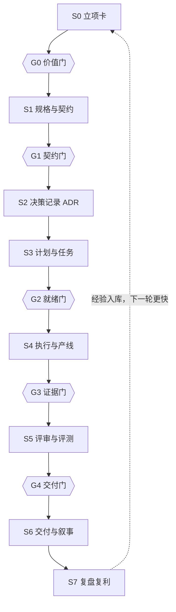

# 从「做完一个项目」到「攒下一套方法」
## ——面向 AI 多智能体项目的个人工作流设计（以智研天工 A17 为样本）

> 版本：2026-11-22 ｜ 适用对象：一人主导、AI 深度参与、交付物是「系统 + 报告 + 答辩」的复杂项目
> 结论先说：**不要照搬任何一家的全量流程**。取 Spec Kit 的「规格即事实源」、OpenSpec 的「变更增量」、BMAD 的「文件交接 + 就绪门」、Compound 的「复盘复利」、ADR 的「决策留痕」、Diátaxis 的「文档分象限」、Memory Bank 的「跨会话记忆」，压成一条 8 阶段的个人闭环。

---

## 一、为什么需要「工作流」而不是「更多文档」

这个项目的实际处境是：

- 交付物多：五智能体系统、四算法、七章报告、25 页 PDF、答辩 PPT、87 份提示词、66 个技能；
- 上下文长：一次全链路跑 180 秒、33 次模型调用、375 条观测，人脑记不住为什么这么设计；
- 返工贵：一个契约字段改错，下游五个阶段全部重跑；
- 经验易蒸发：赛题结束后，真正能带走的不是代码，而是「下次遇到同类问题，我知道先做什么、在哪设卡」。

所以工作流的目标只有三个：**降低返工、留住决策理由、让每次项目都让下一次更快**。文档只是载体，不是目的。

---

## 二、七个代表性方案：核心思路、适用、代价、可借鉴

| 方案 | 星标/来源 | 一句话核心 | 最适合 | 主要代价 |
|---|---|---|---|---|
| GitHub Spec Kit | ★151k | 先写规格，再写计划、任务、代码，最后 converge 校验 | 新功能/新项目从 0 到 1 | 小改动也走全套会偏重 |
| OpenSpec | ★75.4k | 变更用 delta spec 表达（增/改/删），归档后合并进主干规格 | 已有系统的持续迭代（brownfield） | 需要维护 specs/ 与 changes/ 两套目录 |
| BMAD-METHOD | ★55.6k | 角色化智能体分阶段产出文档，**靠文件交接不靠聊天**，进实现前有 readiness 门 | 多角色协作、需要严格交接的复杂系统 | 全量方法重，学习成本高 |
| Compound Engineering | ★26.1k | Plan→Work→Review→**Compound**，把经验写进 docs/solutions/ 供下一轮读取 | 长期反复做同类项目 | 没有复盘习惯就会退化成普通开发 |
| ADR（Nygard / MADR） | adr.github.io | 一页纸记录：背景、选项、决定、后果；只记「难 reversal」的决定 | 技术选型、架构取舍 | 记太细会变成流程负担 |
| Diátaxis | diataxis.fr | 文档分四象限：教程 / 操作指南 / 参考 / 解释，不许混写 | 文档体系化、交接与开源 | 初期拆分成本高 |
| AGENTS.md + Memory Bank | ★25.7k / Cline | 给 Agent 的 README + 六文件项目记忆（brief/context/patterns/progress…） | 跨会话、跨模型持续开发 | 不更新就变成过期文档 |

### 1. GitHub Spec Kit —— 规格驱动开发（SDD）

**核心思路**：把「要做什么、为什么」写成 spec，再由 spec 派生 plan（技术栈与架构）、tasks（可独立验证的小任务），实现后跑 analyze 查一致性、converge 查完整性；每一步产出 Markdown，喂给下一步。它的关键不是模板，而是**每个阶段都有可复查的中间产物**，人和 AI 都在同一份事实源上工作。

**适用**：从零搭系统、需求还在漂移的阶段。
**优点**：返工前移；评审对象从「几千行 diff」变成「一页 spec」。
**代价**：需求稳定的维护型小改动走全套会拖慢；spec 写得空泛就退化成交付文档。
**可借鉴**：constitution（项目宪法：质量/测试/可维护性底线）+ specify/plan/tasks 三段产物 + converge 收口。**你的项目可以直接把「验收标准」写进 spec，而不是写在答辩 PPT 里。**

### 2. OpenSpec —— 增量规格与变更归档

**核心思路**：`specs/` 描述系统**当前是什么样**（as-built），`changes/<name>/` 描述**这次要改什么**，用 ADDED / MODIFIED / REMOVED 三种 delta 表达；改完归档，delta 合并回 specs。它解决的是「规格写完就过期」这个通病。

**适用**：已有系统加功能、多人/多 Agent 并行改同一套契约。
**优点**：变更可审计；MODIFIED 必须带完整原文，强制作者理解现状。
**代价**：目录纪律要求高，偷懒只写 proposal 不写 delta 就失去意义。
**可借鉴**：你的**契约变更**（schema 加字段、枚举改值、门禁阈值调整）正需要这个：每次改契约都留一份 delta，注明影响哪几个阶段、需要重跑什么。

### 3. BMAD-METHOD —— 角色化智能体 + 文件交接 + 就绪门

**核心思路**：分析、产品、架构、开发、测试各有专职 agent，**交接通过文件而非聊天历史**；进入实现前有 implementation readiness 评审；验证阶段要求「测试能映射回需求」。

**适用**：多角色、长链路、需要严格交接的复杂系统。
**优点**：上下文不靠记忆传递；责任边界清晰；就绪门把「没想清楚就开写」挡在外面。
**代价**：全量方法对一人项目偏重；容易产出大量「看起来很正式」的空文档。
**可借鉴**：**文件交接 + 就绪门**这两点，和你的「带 schema 校验的 JSON 产物合同」是同一思路的两种实现——你已经在做，缺的是把「就绪门」显式写成 checklist。

### 4. Compound Engineering —— 让每一轮都复利

**核心思路**：brainstorm → plan → work → simplify → review → **compound**。最后一步把这次学到的东西写进 `docs/solutions/`，下一轮的 brainstorm 和 plan 会先读它。它明确主张：**plan 和 review 应占 80% 时间，写代码只占 20%**。

**适用**：会反复做同类项目的个人或小团队。
**优点**：经验资产化；同类坑不踩第二次。
**代价**：没有强制动作就会跳过 compound，退化成「AI 帮忙写代码」。
**可借鉴**：这是你整套工作流的**发动机**。你的项目已经有《开发总结》和缺陷台账 P-01—P-20，但它们是「结项文档」，不是「下次开工先读的东西」——差别就在**入口位置**。

### 5. ADR —— 决策留痕

**核心思路**：一页纸：背景 → 考虑过的选项 → 决定 → 后果（含接受的代价）。轻量版就一句 Y-statement：「在……背景下，我们决定……，以实现……，接受……」。只在**难逆转、影响面大、有真实取舍**时写。

**适用**：选型（模型、框架、存储）、架构分层、契约设计。
**优点**：半年后还能说清「当初为什么不用另一个」；答辩时「为什么这样设计」直接可答。
**代价**：事事都记会变成负担；写完不维护会误导后来者。
**可借鉴**：你有大量「为什么用确定性算法而不是让 LLM 算」「为什么八态状态机」这类问题——这些正是 ADR 的靶心，也是评委最爱问的。

### 6. Diátaxis —— 文档分四象限

**核心思路**：按「学习/工作」×「实践/认知」分成教程、操作指南、参考、解释四类，四类不许混写。同一段文字若同时服务两个目的，就该拆成两篇。

**适用**：文档要给别人看（交接、开源、招人）。
**优点**：读者各取所需；文档不再是大杂烩。
**代价**：前期要判断「这篇到底属于哪类」。
**可借鉴**：你的 `docs/` 现在是按「来源」分的（答辩/算法/工程交接），可按 Diátaxis 再标一层：**教程=快速开始，操作指南=怎么跑一次全链路，参考=schema 与门禁清单，解释=为什么这么设计**。归档时按用途而不是按时间。

### 7. AGENTS.md + Memory Bank —— 给 Agent 的项目记忆

**核心思路**：`AGENTS.md` 是「给 Agent 看的 README」（构建/测试命令、约定、禁区），嵌套目录可各自覆盖；Memory Bank 用六个文件维护跨会话记忆，其中 `activeContext.md` 更新最频繁、`progress.md` 记录「什么能跑、什么没做、已知问题」。

**适用**：跨会话、跨模型、多人接力。
**优点**：换模型不丢上下文；新人/新 Agent 上手成本固定。
**代价**：不更新就变谎言；文件太多会挤占上下文。
**可借鉴**：你已经在用 `AGENTS.md`/`CLAUDE.md`，但**缺一份 `activeContext`**：当前做到哪、下一步做什么、哪些坑已知。这份文件应该是每天开工第一个读的东西。

### 不建议照搬的

- **arc42 全 12 章**：建筑块视图、运行时视图、部署视图很完整，但对个人项目是过度设计；只取「质量目标 + 建筑块视图 + 关键运行时场景」三节即可。
- **BMAD 全量 agent 阵容**：一人项目养不起 6 个角色，取其「文件交接 + 就绪门」。
- **任何「先写 20 页文档再开工」的做法**：文档超过 3 页没人读，检查点比篇幅重要。

---

## 三、给你的工作流：八阶段闭环「契约—证据—复利」

### 3.1 整体长什么样

一句话：**一条主线（阶段 0→7）+ 三条贯穿线（契约、证据、复利）+ 五道门（G0—G4）**。



三条贯穿线：

- **契约线**：任何跨阶段传递，必须是带 schema 的结构化产物，不是聊天记录。字段、枚举、必填项写死，校验不过不许下发。
- **证据线**：任何结论必须能回溯到证据（数字→来源→页码/URL）。断言核验不通过，不进报告。
- **复利线**：每个阶段结束留一条「可复用物」；项目结束留 3 条经验 + 1—3 个带责任人和日期的行动项。

### 3.2 八阶段明细

#### S0 立项卡（半天）

| 项 | 内容 |
|---|---|
| 目标 | 把「想做什么」压成一页，防止范围蔓延 |
| 关键动作 | 写价值主张（≤50 字）、三类用户、三条验收标准、**明确不做什么**、失败判定 |
| 输入 | 赛题/需求原文、评审规则、既有约束（预算、模型额度、时间） |
| 产出 | `00-项目卡.md`（一页）、验收标准清单 |
| 检查点 G0 | 能否用一句话说清「给谁、解决什么问题、凭什么信」；三条验收标准是否可测量；「不做什么」是否写了 |
| 沉淀物 | 项目卡模板、验收标准写法（可测量动词：≤、≥、覆盖、可回溯） |

#### S1 规格与契约（1—3 天）

| 项 | 内容 |
|---|---|
| 目标 | 把「做成什么样」固化成可校验的契约，而不是口头约定 |
| 关键动作 | 写 `spec.md`（能力清单 + 场景）；定义产物 schema（字段/枚举/必填/嵌套）；画状态机迁移表（白名单）；列门禁清单（G1—G4 各查什么）；补 5 条反例（故意不合规的样例） |
| 输入 | 项目卡、现有系统事实（as-built 规格） |
| 产出 | `01-规格/spec.md`、`contracts/*.schema.json`、`state-machine.md`、`gates.md`、反例集 |
| 检查点 G1 | 所有产物能通过 schema 校验；每个状态迁移都在白名单里；每个门禁有「不过怎么办」；反例必须被拦住 |
| 沉淀物 | 契约模板库（dataset / interpretation / chapter_result 三类）、状态机模板、门禁 checklist |

> 借鉴点：Spec Kit 的「spec 先行」+ OpenSpec 的「as-built 与 delta 分离」+ 你已有的 JSON 产物合同。**契约变更必须写 delta**：改了哪个字段、影响哪几个阶段、要重跑什么。

#### S2 决策记录（随做随写，每篇 15 分钟）

| 项 | 内容 |
|---|---|
| 目标 | 留住「为什么这么选」，把答辩问题提前答掉 |
| 关键动作 | 只在难逆转/影响面大时写 ADR；用 Y-statement 起头，补「考虑过的另一个方案 + 放弃理由 + 接受的代价」；编号 D-01 起 |
| 输入 | 选型讨论、对比实验数据 |
| 产出 | `02-决策/D-xx-标题.md`（半页到一页） |
| 检查点 | 是否写了至少一个被放弃的选项；是否写了代价；是否有可验证的证据（不是「感觉更好」） |
| 沉淀物 | 决策台账（一张表：编号/主题/结论/代价/复核时间）；答辩「为什么不用 X」素材库 |

> 你的四算法（DPE / 稳健 Z / CLA / RPD）、八态状态机、确定性计算 vs LLM 生成，每一个都值得一篇 ADR。

#### S3 计划与任务（半天到一天）

| 项 | 内容 |
|---|---|
| 目标 | 把规格拆成「能独立验证」的小块，排好依赖 |
| 关键动作 | 写 `plan.md`（技术路线、模块边界、接口）；拆 `tasks.md`（每任务 ≤ 半天、有验收命令、有依赖标注）；标出关键路径与可并行项 |
| 输入 | 规格、契约、ADR |
| 产出 | `03-计划/plan.md`、`tasks.md`（勾选式） |
| 检查点 G2 | 每个任务是否有「怎么算做完」；是否有任务无法独立验证（需再拆）；关键路径是否只有一条 |
| 沉淀物 | 任务模板（动词开头 + 验收命令 + 预估）、估时校准表（计划 vs 实际） |

#### S4 执行与产线（主体工期）

| 项 | 内容 |
|---|---|
| 目标 | 按契约产出，过程可复现、可回滚 |
| 关键动作 | 每次运行落 `run_id` + 产物清单 + 耗时/调用次数；提示词版本化（编号 + 变更说明 + 关联任务）；失败分「可重试/不可重试」，重跑生成新修订号不覆盖旧记录；代码改动先跑单测与门禁再合并 |
| 输入 | 任务清单、契约、提示词资产 |
| 产出 | 代码与产物、`runs/<run_id>/`、提示词注册表、失败台账 |
| 检查点 | 单测/门禁是否绿；是否所有产物都带 schema 校验；是否出现「改一处、下游静默错」的情况 |
| 沉淀物 | 提示词注册表（编号/用途/输入输出/版本/关联契约）、技能包、失败模式清单 |

> 借鉴点：BMAD 的「文件交接」你已经做到；补上 Compound 的「simplify」——实现完先做一轮删繁（去死代码、去无用测试），再进评审。

#### S5 评审与评测（1—2 天，穿插进行）

| 项 | 内容 |
|---|---|
| 目标 | 用证据而不是自信来判断「能不能交」 |
| 关键动作 | 三类评审并行：契约评审（schema/状态机）、事实评审（数字口径、断言核验）、体验评审（端到端跑一遍）；发现问题按 P0—P3 分级，P0/P1 必须修，P2 记账，P3 记录不修；评测集固定（同一批 case 每轮都跑） |
| 输入 | 产物、评测集、标注集、口径手册 |
| 产出 | 评审报告、缺陷台账（编号/严重级/根因/修法/状态）、评测指标表 |
| 检查点 G3 | 关键指标是否达标（如断言拦截率 ≥80%、误删率 ≤10%）；P0/P1 是否清零；是否有「未标定」的检测项被当成已完成 |
| 沉淀物 | 评测集与标注集、缺陷台账模板、指标口径定义（避免下次口径漂移） |

#### S6 交付与叙事（1—2 天）

| 项 | 内容 |
|---|---|
| 目标 | 让「陌生人 30 分钟能跑通、10 分钟能听懂」 |
| 关键动作 | README 六问（是什么/怎么跑/依赖什么/输出什么/边界在哪/去哪看细节）；做一次「干净机器」复现；准备三层叙事：一句话 → 三段机制 → 证据与数字；归档大文件（Release/LFS），仓库只留可维护内容 |
| 输入 | 系统、报告、评测结果 |
| 产出 | README、快速开始、交付包、答辩材料、Release |
| 检查点 G4 | 新人按 README 能否跑通；每个数字是否有一句「怎么算的」；每个能力是否有对应证据 |
| 沉淀物 | 交付清单（可勾选）、叙事模板（痛点→机制→证据→边界）、常见追问 20 问 |

#### S7 复盘复利（半天，结项必做）

| 项 | 内容 |
|---|---|
| 目标 | 把这次的经验变成下次的起点 |
| 关键动作 | 30 分钟无指责复盘：做对了什么/哪里卡住/下次改什么；写 3 条经验进 `docs/solutions/`，每条四段：症状→根因→修法→复用场景；只留 1—3 个行动项，带责任人和日期；更新 `activeContext.md` 与 `AGENTS.md`；把过时文档按「保留/归档/删除」处理 |
| 输入 | 缺陷台账、评测表、决策台账、运行记录 |
| 产出 | `solutions/*.md`、复盘纪要、行动项清单、更新后的项目记忆 |
| 检查点 G5 | 上一轮行动项完成率是否 ≥ 2/3；新经验是否被下一轮 plan 引用过（引用次数=复用率） |
| 沉淀物 | 经验条目库、模板库更新、工作流本身（这份文档的下一版） |

---

## 四、这套工作流「整体是什么样子」

用一句话描述：**它是一条带闸门的流水线，前面重思考、中间重契约、后面重复盘；每过一个闸门，返工成本就下降一个量级。**

- **形状**：不是直线，是**螺旋**。S7 的产出（经验条目、模板、检查点）回流到 S0，下一轮同类项目直接从更高的起点开始。
- **节奏**：S0—S3 占约 40% 时间（想清楚），S4 占 40%（做出来），S5—S7 占 20%（证明与沉淀）。这与 Compound 主张的「plan + review 占大头」一致，只是把「review」拆成了「评审 + 交付 + 复盘」。
- **判断标准**：不看文档数量，只看四个指标——
  1. **返工率**：同一模块是否需要二次大改（目标：每个模块 ≤1 次）；
  2. **首次通过率**：一次跑通门禁的比例（目标：≥70%）；
  3. **复用率**：沉淀物被下一次项目引用的次数（目标：每项目 ≥3 次）；
  4. **交接成本**：新人跑通所需时间（目标：≤30 分钟）。
- **最小可用版**：如果只有精力做三件事，就做 **S1 契约 + S5 证据 + S7 复盘**。这三件决定项目能不能交、能不能复用；其余可以简化。

---

## 五、落到这个项目：目录与首周动作

建议目录（在现有 `docs/` 上增量，不推翻）：

```
docs/
├── 00-项目卡/            # S0：一页项目卡 + 验收标准
├── 01-规格/              # S1：spec、contracts、state-machine、gates、反例
├── 02-决策/              # S2：D-01…D-xx
├── 03-计划/              # S3：plan、tasks
├── 04-评测/              # S5：评测集、标注集、指标口径、缺陷台账
├── 05-交付/              # S6：README、快速开始、交付清单、20 问
├── 06-沉淀/solutions/    # S7：经验条目
└── archive/              # 归档（按用途而非时间）
```

首周可做的五件事（按性价比排序）：

1. 把《开发总结》里的「遗留问题」拆成 `缺陷台账`（带严重级、根因、修法），这是最现成的复利素材；
2. 给四算法各写一篇 ADR（半页），直接变成答辩「怎么实现、为什么这么做」的答案；
3. 把现有的契约产物（dataset / interpretation / chapter_result）补成正式 schema 文件 + 5 条反例；
4. 建 `activeContext.md`：当前状态、下一步、已知坑，每天开工先读；
5. 定 G1—G4 四张 checklist，每张不超过 10 项，贴到仓库里。

---

## 六、边界与风险

- **不要文档表演**：一页能说清的事不写三页；检查点不超过 10 项，否则没人执行。
- **不要把流程当能力**：工作流只降低返工，不提升模型上限；模型能力问题要靠评测与提示词工程解决。
- **诚实标注**：这套流程里，S5 的「评测集固定、指标口径固定」是最容易被跳过、也最影响可信度的一环；跳过它，前面所有文档都会变成自我感觉良好。
- **可裁剪**：小改动走「S1 delta → S4 → S5 轻量评审」即可，不必八阶段全走。

---

## 附：参考来源

- GitHub Spec Kit：https://github.com/github/spec-kit ｜ 文档 https://github.github.com/spec-kit/
- OpenSpec：https://github.com/Fission-AI/OpenSpec ｜ https://openspec.dev/docs/quickstart
- BMAD-METHOD：https://github.com/bmad-code-org/BMAD-METHOD ｜ https://docs.bmad-method.org/reference/workflow-map/
- Compound Engineering：https://github.com/EveryInc/compound-engineering-plugin ｜ https://every.to/source-code/compound-engineering-the-definitive-guide
- ADR：https://adr.github.io/adr-templates/
- Diátaxis：https://diataxis.fr/
- AGENTS.md：https://agents.md/
- Cline Memory Bank：https://docs.cline.bot/best-practices/memory-bank
- arc42：https://arc42.org/overview
- Sprint Retrospective：https://www.scrum.org.cn/learning-series/sprint-retrospective
