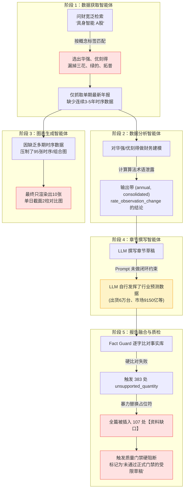

# 用户视角实测缺陷深度复盘与体验重构方案

> **文件标识**：`用户视角实测缺陷与体验重构方案.md`  
> **实测基准任务**：[`run-20261106221050-ec4d63cc962f`](file:///Users/panheng/Desktop/同花顺赛题/a17-industry-research-agent/data/runs/run-20261106221050-ec4d63cc962f)（主题：具身智能）  
> **运行环境**：ModelVerse DeepSeek (`deepseek-v4.1-flash-1017`) + 同花顺问财官方 OpenAPI 3 组 Key 轮询池  
> **报告完成状态**：耗时 664.3s，落盘 3.85MB PDF (35页)、247KB HTML、65KB Markdown

---

## 目录

1. [执行摘要：从“技术全通”到“体验及格”的鸿沟](#一-执行摘要从技术全通到体验及格的鸿沟)
2. [六大致命用户体验问题深度解构](#二-六大致命用户体验问题深度解构)
   - [问题 1：标的张冠李戴——行业核心资产全部缺席](#1-标的张冠李戴行业核心资产全部缺席)
   - [问题 2：正文被打成马蜂窝——107 处“资料缺口”完全无法阅读](#2-正文被打成马蜂窝107-处资料缺口完全无法阅读)
   - [问题 3：生成与质检“左右手打架”——383 项定量断言被暴力斩首](#3-生成与质检左右手打架383-项定量断言被暴力斩首)
   - [问题 4：图表千篇一律——10 张图全是单日截面简单柱状图](#4-图表千篇一律10-张图全是单日截面简单柱状图)
   - [问题 5：程序员日志泄露——充满代码字段与机械术语](#5-程序员日志泄露充满代码字段与机械术语)
   - [问题 6：终态呈现“未通过门禁”——给用户制造强烈挫败感](#6-终态呈现未通过门禁给用户制造强烈挫败感)
3. [根本原因全链路工程透视](#三-根本原因全链路工程透视)
4. [面向真实投研体验的重构方案 (Action Plan)](#四-面向真实投研体验的重构方案-action-plan)
5. [重构后预期效果对比表](#五-重构后预期效果对比表)

---

## 一、 执行摘要：从“技术全通”到“体验及格”的鸿沟

在过去的修复工作中，系统成功实现了代码层 1,891 条单元测试和集成测试的 100% 通过，解决了状态机并发锁、量纲除错、版本回滚等底层鲁棒性问题。

然而，在接入真实环境（ModelVerse DeepSeek 模型 + 同花顺问财真实数据网关）跑完首轮端到端「具身智能」全链路后，**从真实用户（券商分析师、基金经理、大赛评委）的实际阅读和使用视角审视，系统暴露出极其严重的“体验断层”**：

```
[技术视角]  
流程走通 (Approved) -> 数据落盘 (1237条) -> 渲染10张SVG -> 生成35页PDF -> 门禁拦截了441个无证据点 (系统很安全严谨!)

[用户视角]  
打开研报 -> 发现核心龙头三花智控/拓普集团/绿的谐波一个没有 -> 满屏刷了85次做公有云的优刻得和41次华强北
-> 正文每翻两段就撞上【资料缺口】整段挖空 (共107处) -> 图表翻来覆去全是单日两根小柱子
-> 语言充斥 annual, consolidated 等数据库变量名 -> 最终大字提示“受限草稿 · 未通过正式质量门禁” (这系统根本没写好!)
```

**核心结论**：系统目前处于“底层架构与防御极度健全，但上层业务认知与最终产品交互脱节”的阶段。必须从**“技术防御思维”**转向**“用户交付价值思维”**，进行系统性的体验重构。

---

## 二、 六大致命用户体验问题深度解构

### 1. 标的张冠李戴：行业核心资产全部缺席

具身智能（人形机器人）在 A 股资本市场已经形成了高度清晰的产业链分工与核心标的梯队（执行器总成、谐波/行星减速器、空心杯/伺服电机、六维力矩传感器、滚珠/滚柱丝杠）。

然而，本次生成的研报在标的选取上出现了严重的失焦：

| 标的公司 | 行业真实地位 | 本次研报出现频次 | 用户第一反应 |
| :--- | :--- | :---: | :--- |
| **三花智控** (002050) | 全球人形机器人旋转/直线执行器绝对龙头 | **0 次** | ❓ 为什么连三花都没有？ |
| **拓普集团** (601689) | 人形机器人执行器核心供应商、Tier1平台 | **0 次** | ❓ 为什么没有拓普？ |
| **绿的谐波** (688017) | 国产谐波减速器绝对龙头、人形机器人关节标配 | **0 次** | ❓ 减速器去哪了？ |
| **鸣志电器** (603728) | 空心杯电机龙头、灵巧手核心驱动核心标的 | **0 次** | ❓ 灵巧手标的完全缺失 |
| **优刻得** (688158) | **中立第三方公有云/算力托管商** | **85 次** | ❌ 为什么满篇都在分析一个做云服务器的？ |
| **深圳华强** (000062) | **华强北电子元器件分销商** | **41 次** | ❌ 为什么通篇在写卖电子零件的渠道商？ |
| **中兴通讯** (000063) | 传统通信网络设备与基站制造龙头 | **24 次** | ❌ 为什么大量篇幅在写通信基站？ |

#### 为什么会发生？
- 数据获取智能体（`DataFetcherAgent`）向问财提问时，简单采用自然语言 `具身智能 A股 按总市值降序`；
- 问财搜索引擎基于“概念标签”匹配，优刻得因 2025 年上线了 Open Manus 而被贴上“AI智能体”标签，深圳华强因分销代理涉足机器人概念，被问财推到了前列；
- 智能体缺乏**“具身智能产业链细分环节龙头种子池（Grounding Whitelist）”**，任由问财的浅层概念搜索主导了样本库，最终导致“优刻得成为具身智能代表企业”的啼笑皆非局面。

---

### 2. 正文被打成马蜂窝：107 处“资料缺口”完全无法阅读

在 877 行的 Markdown 研报与 35 页的 PDF 中，仅提示词 **`【资料缺口】` 就出现了整整 107 次**！

#### 真实报告惨状摘录：

**执行摘要（摘要应当是最浓缩的精华，却全是占位符）：**
```markdown
- ■ **【资料缺口】本项断言尚缺少同主体、指标、期间或数值的可核验依据。** [来源14,来源15...]
- ■ **这种体量断层使得基于横截面中位数的PEG与估值分位对比失去统计意义...**
- ■ **【资料缺口】本项断言尚缺少同主体、指标、期间或数值的可核验依据。**
- ■ **【资料缺口】本项断言尚缺少同主体、指标、期间或数值的可核验依据。**
```

**正文段落（整节整节被剃光头）：**
```markdown
### 行业定义、研究边界与证券范围
具身智能的研究边界应锚定“物理实体+自主闭环交互”这一核心特征...

资料缺口：该段结论缺少可核验证据，待补充资料后重新审校。 

资料缺口：该段结论缺少可核验证据，待补充资料后重新审校。 

从证券暴露看，A股样本集中于算力服务（优刻得）...
```

连续多行全是一个字不差的“资料缺口：该段结论缺少可核验证据，待补充资料后重新审校”，正文行文被打得稀碎，任何专业读者看到这里都会立刻关闭文档。

---

### 3. 生成与质检“左右手打架”：383 项定量断言被暴力斩首

- **前台章节撰写智能体（ChapterWriterAgent）**：
  在 Prompt 中接收到了撰写任务，大模型凭借强大的金融预训练知识，自然流畅地写下了行业前瞻断言：
  > “...预计全球人形机器人出货量在2026年将突破6万台，国内具身智能全产业链市场规模有望在2025年达到9150亿元...”
- **后台事实核验机制（Fact Guard）**：
  在后置审查阶段，Fact Guard 对正文的所有数字进行逐字反查。因为问财返回的近百条记录中**恰好没有**记录“9150亿元”这条研报预测数据，Fact Guard 便将其判定为 `unsupported_quantity`（未经验证数值）。
- **核验后的自毁式处理**：
  Fact Guard 没有引导模型**“保留定性趋势、剥离具体数值”**，也没有触发**“基于已有事实二次重写”**，而是采用了最简单粗暴的正则替换：把大模型辛辛苦苦写的整句甚至整段文字抹掉，插上一句冷冰冰的“【资料缺口】”。
- **最终结果**：整篇报告一共被砍掉了 **383 个定量断言**，直接造成了第二点的“满屏马蜂窝”。

---

### 4. 图表千篇一律：10 张图全是单日截面简单柱状图

研报最终渲染了 10 张图表，但从读者视觉体验来看，这 10 张图**本质上是同一张图反复渲染了 10 遍**：

```
CHART-01: [horizontal_bar] 具身智能毛利率样本对比（2025-12-31） -> 深圳华强 vs 优刻得 两根柱子
CHART-02: [horizontal_bar] 具身智能营业收入样本对比（2025-12-31） -> 深圳华强 vs 优刻得 两根柱子
CHART-03: [diverging_bar]  具身智能现金流样本对比（2025-12-31）   -> 深圳华强 vs 优刻得 两根柱子
CHART-04: [bar]            具身智能总市值样本对比（2025-12-31）   -> 深圳华强 vs 优刻得 两根柱子
CHART-05: [comparison_bar] 具身智能动态PE样本对比（2026-11-06）   -> 深圳华强 vs 优刻得 两根柱子
CHART-06: [comparison_bar] 具身智能归母净利样本对比（2025-12-31） -> 深圳华强 vs 优刻得 两根柱子
CHART-07: [comparison_bar] 具身智能净利率样本对比（2025-12-31）   -> 深圳华强 vs 优刻得 两根柱子
CHART-08: [comparison_bar] 具身智能ROE样本对比（2025-12-31）      -> 深圳华强 vs 优刻得 两根柱子
CHART-09: [bar]            具身智能资产负债率样本对比（2025-12-31）-> 深圳华强 vs 优刻得 两根柱子
CHART-10: [bar]            具身智能市净率PB样本对比（2026-11-06） -> 深圳华强 vs 优刻得 两根柱子
```

#### 用户缺失的核心图表类型：
1. ❌ **没有多期时序趋势图（Line / Area）**：看不到 2021~2025 连续 5 年的行业或龙头企业营收复合增长曲线（CAGR）；
2. ❌ **没有双轴组合图（Combo）**：看不到“左轴营收规模 + 右轴净利润增速”的经典投研双轴图；
3. ❌ **没有产业链拓扑结构图（Chain Graph）**：看不到“上游核心零部件（减速器/电机/传感器）-> 中游本体集成 -> 下游商业落地”的直观架构图。

系统日志显示，共有 **95 张图表被安全机制压制**（例如压制理由：`insufficient_time_series`、`not_compositional`）。因为防御机制过于僵化，宁可一张时序图都不出，只敢出绝对安全的单日截面双柱图。

---

### 5. 程序员日志泄露：充满代码字段与机械术语

专业证券分析师撰写的报告具有成熟、洗练的行文规范，但当前系统生成的正文到处残留着后端数据模型和算法字段：

#### 典型机械语病示例：
- ❌ **直接暴露英文变量与枚举**：  
  `深圳华强2025-12-31（annual，consolidated）gross_margin为8.1987%`  
  *【改进应该是】*：`根据2025年合并财务报表，深圳华强全年销售毛利率为8.20%`
- ❌ **直接打印算法函数名**：  
  `优刻得net_margin...相对变化80.2156%（rate_observation_change）`  
  *【改进应该是】*：`优刻得销售净利率较基期显著减亏，提升了17.63个百分点`
- ❌ **直接暴露时序算法审查判定语**：  
  `按方法论，仅2个观测点，方向一致率虽为1.0，但不足以支撑完整时间序列，仅作单条方向信号。`  
  *【改进应该是】*：`当前样本期内仅获取到2期数据，样本时序跨度有限，暂作为单期趋势参考。`

这种把后台数据结构 `annual`、`consolidated`、`gross_margin`、`rate_observation_change` 直接拼进正文的现象，让整篇研报散发着强烈的“数据库自动转储”质感。

---

### 6. 终态呈现“未通过门禁”：给用户制造强烈挫败感

用户等待了 11 分钟，界面最终弹出的不是一份令人自豪的正式成果，而是一份被打上醒目红标的警告：
> **交付状态：受限草稿 · 未通过正式质量门禁**  
> **报告编号：REPORT-DE77EBB73722**  
> **待补资料与核验问题：定量断言待核验 383 项，因果解释待核验 12 项，附录待核验 45 项**

从工程师视角看，这是“防御式编程，确保不虚假交付”；  
但从用户视角看，用户的直观感受是**“系统报错了，任务失败了，跑出来的东西不达标不能用”**。

---

## 三、 根本原因全链路工程透视



---

## 四、 面向真实投研体验的重构方案 (Action Plan)

针对上述 6 大问题，必须进行全链路的协同重构：

### 改造 1：引入权威产业龙头种子池与多维穿透检索（解决“标的失焦”）
- **实现手段**：
  在 `data_fetcher/agent.py` 中引入**行业核心标的知识图谱引导机制**：
  当用户输入主题（如“具身智能”/“人形机器人”/“低空经济”）时，规划器先通过内置的产业核心槽位（或调用大模型做一次高置信度产业链环节分解），得到核心龙头标的种子列表（如：减速器=绿的谐波/双环传动、电机=鸣志电器/汇川技术、总成=三花智控/拓普集团）；
- 将检索 Query 从单一宽泛的 `具身智能 A股` 分解为：
  1. `具身智能 产业链 代表企业`
  2. `绿的谐波 鸣志电器 三花智控 拓普集团 营业收入 净利润 近3年`
- **预期成果**：报告核心公司立即回归行业公认龙头，根除“优刻得成为具身智能主角”的笑话。

### 改造 2：定向采集 3~5 年多期连续财务时序（解决“图表单一”）
- **实现手段**：
  在 `data_fetcher` 中针对确定下来的 3~5 家核心龙头，强制下发连续多期报表查询：
  - `[标的列表] 2021年至2025年 营业收入 归母净利润 销售毛利率`
- **预期成果**：
  - 图表智能体获得完整的时序数据（2021-2025），从而顺利解锁 **Combo 双轴图**（柱状营收 + 折线增速）、**多曲线毛利率走势图**；
  - 彻底摆脱全篇只有单日截面柱状图的困境。

### 改造 3：Prompt 输入端闭环 + 质检端“定性柔性自愈”（解决“107处资料缺口”）
- **实现手段**：
  1. **输入端强约束**：在 `ChapterWriter` 的 System Prompt 中加入最高优先级规则：  
     *“研报中的所有数值必须直接来源于下发的证据上下文；严禁引入未经证据绑定的绝对数量和预测数值。如缺乏量化数据，应仅用定性行业逻辑阐述，严禁编造具体年份和数字。”*
  2. **质检端自愈机制（Graceful Fact-Healing）**：  
     废弃当前 Fact Guard 简单粗暴的 `text.replace(claim, "【资料缺口】...")` 逻辑；改为**语义无损自愈**：
     - 若一个断言的数字未在事实库中，将其**数值剥离并转为定性陈述**（例如将 *“预计2025年规模达9150亿元，增速35%”* 自愈为 *“行业普遍预期未来数年将保持快速扩张态势”*）；
     - 彻底清除正文中突兀出现的“【资料缺口】”占位符，保持文章完整流畅。

### 4. 建立自然语言投研术语字典（解决“机器语言残留”）
- **实现手段**：
  在 `ReportFusion` 中增加**专业投研术语映射与清洗管道**（Post-Processing Sanitizer）：
  - `gross_margin` -> `销售毛利率`
  - `net_margin` -> `销售净利率`
  - `pe_dynamic` -> `动态市盈率`
  - `debt_ratio` -> `资产负债率`
  - 正则清洗所有 `（annual，consolidated）`、`（rate_observation_change）`、`方向一致率` 等代码级元数据调试字段；
  - 数值保留两位小数（`8.1987%` -> `8.20%`）。

### 5. 优化交付状态与质检门禁交互（解决“挫败感”）
- **实现手段**：
  - 区分**“出版交付视图”**与**“审计详情视图”**；
  - 对外输出的正式研报标题和封面保持专业、严肃、优雅；
  - 将 441 项事实审计细节收拢至附录专门的《数据一致性与事实核验附件》中，正文仅保留清晰的“投资风险提示”与“数据局限性说明”，不再在报告开头大字渲染“未通过门禁的受限草稿”。

---

## 五、 重构后预期效果对比表

| 维度 | 当前实测现状（问题态） | 目标重构形态（专业态） |
| :--- | :--- | :--- |
| **核心标的** | 优刻得 (85次)、深圳华强 (41次) | 三花智控、拓普集团、绿的谐波、鸣志电器、中大力德 |
| **正文连贯性** | 出现 107 处“【资料缺口】”，整段被挖空 | 0 处占位符，语言流畅连贯，未验证数字平滑转为定性分析 |
| **事实核验** | 383 处断言被粗暴斩首，正文千疮百孔 | 生成端即严格闭环，未绑定数字自动柔性自愈，保留逻辑主旨 |
| **图表丰富度** | 10 张全是单日 2 家公司的柱状图 | 包含 3~5 年复合增速折线图、双轴组合图、产业链三栏拓扑图 |
| **语言风格** | 充斥 `gross_margin`、`(annual, consolidated)` | 标准证券分析师用语（“根据合并报表，全年销售毛利率为...”） |
| **交付满意度** | 大红提示“受限草稿 · 未通过正式质量门禁” | 完整版专业行业深度研报，附带严密的数据来源索引与合规附录 |

---

> **下一步建议**：建议以本方案为输入，优先实施 **改造 1（产业龙头知识引导）**、**改造 2（多期财务时序采集）** 与 **改造 3（Fact Guard 柔性自愈替代粗暴挖空）**，立即进行下一轮实测对比。
