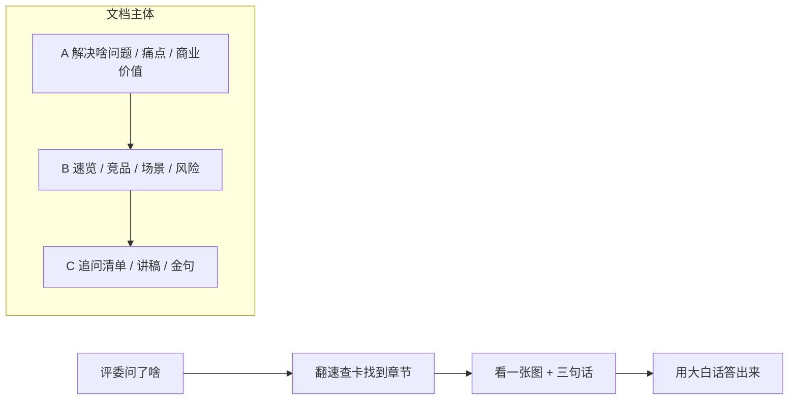

# 答辩备答文档 · 交接说明

> **先看这一句**：这份文件不是答辩文档，是**我交给你的活儿清单**。
> 我要你照着它，写出一份《答辩备答文档》给全队用。你手上拿的是"要写什么、写成什么样、什么时候算写完"，不是成品。

写给人：负责答辩文档的同学
写的人：项目负责人
日期：2026-11-09
口径：大白话，看不懂就当我没写清楚，直接来问

---

## 0. 一句话任务卡

| 项 | 内容 |
| --- | --- |
| **我要什么** | 一份《答辩备答文档》，让全队**熟悉项目、被评委追问时能马上答上来** |
| **给谁用** | 答辩主讲人、被点名接话的人、赛前临时抱佛脚的人 |
| **最要紧的三件事** | ① 这项目到底解决什么问题 ② 用户原来有多难受 ③ 做出来有什么市场／商业价值 |
| **写完的标志** | 随便拉一个没写过代码的同学，读 10 分钟，能用自己的话讲清上面三件事，并且被追问不卡壳 |
| **别做成什么** | 不是技术白皮书、不是代码说明、不是给评委的正式产品手册、不是论文 |

一句话定位：**评委问什么，我们能十秒内翻到答案。**

---

## 1. 目标与受众

### 1.1 为什么要这份文档（大白话）

现在队里的麻烦不是"东西没做出来"，是**讲不清楚**：

- 三个人讲同一个项目，说法不一样；一个说"多智能体"，一个说"报告生成器"，评委听完不知道这是干嘛的。
- 一被追问就卡：问"谁会买"，我们开始背架构；问"数据准不准"，我们开始背测试数量。
- 技术词太多，句句是 `状态机`、`证据链`、`CAS`，评委不是来听我们背术语的。
- 赛前 30 分钟想临时补一下，翻白皮书 4 万字，根本来不及。

所以这份文档的活儿就一个：**把项目翻译成人话，再把可能被问到的问题提前答一遍。**

### 1.2 谁会看、什么时候看

| 谁 | 什么时候 | 他想拿到什么 |
| --- | --- | --- |
| 主讲人 | 赛前一晚 | 把讲稿和 PPT 的要点顺一遍，别讲偏 |
| 被点名接话的人 | 答辩现场 | 快速翻到某一节，照着答，不冷场 |
| 全队 | 赛前 30 分钟 | 一页纸看完，统一口径 |
| 写 PPT / 录演示视频的人 | 准备材料时 | 直接抄句子、直接拿图 |
| 评委（如果他要材料） | 现场 | 看得懂、不觉得我们在吹 |

### 1.3 读完要能做到

- [ ] 用一句大白话说清"这东西是干嘛的"
- [ ] 说清原来干这活儿有多麻烦，我们省掉了哪几步
- [ ] 说清谁会用、谁可能掏钱、钱从哪儿省出来
- [ ] 被问"和直接问 ChatGPT 有啥区别"，能答得上来
- [ ] 被问"你们现在还有啥没做完"，能老实答，不慌

---

## 2. 最终文档要写哪些内容

分三档：**A 必须写**（我点名的重点）、**B 建议写**（不写答辩容易吃亏）、**C 放开写**（我帮你想到的，你还能继续加，不用问我）。

### A 档 · 必须写，写不透不算完成

| 编号 | 模块 | 具体要写什么 | 写到什么程度 |
| --- | --- | --- | --- |
| A1 | **项目到底解决什么问题** | 一句话版本、一段话版本、"以前怎么干 / 现在怎么干"对照表 | 一句话版本要短到能印在 PPT 首页；对照表至少 4 行 |
| A2 | **用户痛点** | 按角色分开写：券商／基金分析师、研究助理、中小机构、个人研究者。每个痛点写"具体场景 + 有多难受 + 我们怎么接住" | 至少 4 类角色、每类 2 个以上痛点；要有具体场景，不许只写"效率低" |
| A3 | **市场与商业价值** | 谁会掏钱、省了什么、怎么算这笔账、有哪几种落地方式、为什么是现在 | 至少 3 种落地方向；算账给公式和假设，不许直接甩一个市场规模数字 |

#### A1 的参考底子（别照抄，用自己的话写）

我们做的事：输入一个行业名（比如"低空经济"），系统自己去找数据、读数据、画图、写七章、合成报告，中间每个环节人都能插手改，最后交出 Markdown / HTML / PDF 三份东西。**不是替分析师做判断，是替他把找数、搬数、画图、排版这些体力活干掉，判断留给人。**

#### A2 有个坑，一定要分清楚

| | 这类痛点 | 在文档里怎么用 |
| --- | --- | --- |
| ① **行业原本就有的痛** | 写一份 20–50 页深度研报要几天甚至几周；数据散在几个库里、口径打架（三表、宏观、公告、研报对不上）；直接用大模型写会编数字、编来源，机构不敢用 | **这是主卖点，重点写、放开写** |
| ② **我们自己实测暴露的问题** | 之前具身智能那次真实跑通，出现过核心龙头公司一个没选上、正文刷了 107 处"资料缺口"、图表全是单日小柱子、正文里漏出 `annual`／`consolidated` 这种数据库字段名、最后大字提示"受限草稿·未通过质量门禁" | **别当卖点吹**，放到"我们怎么发现问题、怎么一轮轮修"和"现在还有啥没做完"里。评委问"你们有什么短板"时照实答，反而显得靠谱 |

> 千万别把②藏起来装作没有。评委一追问"那你们真实跑过吗"，藏不住；主动讲清楚"我们发现过、修到哪一步了"，比硬吹强得多。

#### A3 算账怎么写才不挨打

- 给**公式和假设**，例如：`省下的时间 ≈ 原来查数+搬数+画图的小时数 × 每月报告数 × 人力单价`
- 每个假设写清楚是谁估的、依据在哪，**没核实的直接标 `[待核实]`**
- **红线：不许编市场规模、客户数、渗透率、营收预测。** 一个编出来的数字，够评委把整场答辩问穿。真要写行业规模，必须带"来源 + 年份 + 地域口径"，或者干脆不写。
- 边界也要写：不给投资建议、不替分析师签字、不承诺"全自动出正式研报"。

### B 档 · 建议写，答辩基本会被问到

| 编号 | 模块 | 要点 |
| --- | --- | --- |
| B1 | 一页纸项目速览 | 五阶段流水线（取数→解读→图表→分章节→融合）、7 章 21 节、三格式输出、每阶段能人工审核 |
| B2 | 技术亮点的"人话翻译" | 每个术语做三列：`术语` / `说人话就是` / `评委追问时怎么答`。至少覆盖：证据编号 `record_id`、状态机与版本冲突、受限交付、零黑盒、SkillHub 技能调用 |
| B3 | 竞品／替代办法对比 | 对比对象：纯人工写、通用大模型直接写、现成研报平台、别的 Agent 工具。维度：数据可不可信、能不能溯源、能不能中途改、出不出 PDF、有没有人把关 |
| B4 | 落地场景故事 | 一个分析师从输入"低空经济"到拿到 PDF 的一整天，用时间线讲，别用流程图讲 |
| B5 | 数据／证据佐证 | 离线回归通过数、真实跑通过的样例（具身智能、动力电池）、PDF 页数与体积、五个演示行业。**写之前找开发同学复核最新数字**，白皮书里的数字是 2026-11-06 的快照 |
| B6 | 演示脚本 | 3 分钟讲什么、10 分钟讲什么、现场点哪几个按钮、万一演示卡了怎么接 |
| B7 | 风险与边界（老实写） | 外部大模型会限流（429）、财务单元公告原文核验还没 100% 自动覆盖、产业链证据闭环还在做、系统没有登录鉴权所以不能挂公网 |
| B8 | 下一步计划 | 模型灾备与自动降级、超大文件拆分、对象存储／多租户 |
| B9 | 对齐赛题评分点 | 把赛题"任务要求"六条逐条对上"我们做了啥 / 在哪能看到 / 哪份材料能证明" |
| B10 | 团队分工与开发过程 | 谁做哪块、踩过什么坑、怎么爬出来的（赛题明确要交这份材料，顺手准备） |

### C 档 · 放开写，想到就加（不用受限、不用问我）

这些是我先替你想到的，**你可以继续往上加**：

1. **评委可能问的 20+ 个问题 + 回答要点**，按"问价值的 / 问技术的 / 专门挑刺的"分三类
2. **三个时长的讲稿**：30 秒电梯版、1 分钟版、3 分钟版
3. **金句库**：能直接印在 PPT 上的短句，10 条左右
4. **禁词表**：不许说的说法（"100% 准确""完全自动""替代分析师""可直接用于投资决策"）
5. **术语小词典**：把项目黑话翻成大白话，一页搞定
6. **常见误解澄清**："这不就是套壳 ChatGPT 吗""是不是爬别人数据""能直接指导买卖吗""和同花顺自家产品撞不撞"
7. **Q&A 速查卡**：A4 一页，现场摊桌上，问题→去文档第几节
8. **素材包索引**：截图清单、图源文件、演示视频时间码、样例报告路径
9. **版本记录**：谁改的、改了啥、哪版是答辩当天用的
10. **"如果只能记住三句话"**：给最忙的人
11. **反面问答**：评委说"这个我听不懂"时，怎么换一种说法重讲
12. **行业样例小档案**：白酒、半导体设备、光伏、低空经济、新能源汽车，每个一句"为什么选它、演示时看什么"
13. **和同花顺 iFinD / SkillHub 的关系图**：我们站在人家数据能力之上做"交付层"，不是另起炉灶
14. **社会价值**：减少重复劳动、让中小机构也用得起研究工具（别写太大，收着写）
15. **成本与定价的粗想法**：按份 / 按席位 / 按调用量，写思路就行，别写具体价

> C 档不是"可选装饰"，是我特意留的口子。你觉得哪块能让评委少追问一句，就加哪块，**不用回来问我**。

---

## 3. 图表呈现要求（重点：图要多）

### 3.1 硬性数量

- **至少 8–10 张图**，平均每 1–2 页一张；宁可少写字，也要多画图。
- 每张图下面配一句"**这张图想说明啥**"，一句话，别写段落。
- 图必须能**单独截图放进 PPT**，所以别做整页花花绿绿的背景图。

### 3.2 图清单（照着画就行）

| # | 图名 | 画什么 | 建议形式 | 素材在哪 |
| --- | --- | --- | --- | --- |
| 1 | 一页纸总览 | 输入行业名 → 五个阶段 → 三格式报告 | 横向流程 | 白皮书第 2、3 章 |
| 2 | 痛点地图 | 角色 × 痛点 × 我们怎么接住 | 三列矩阵 | 本说明 A2 |
| 3 | 前后对比 | 人工写研报的步骤 vs 用我们之后的步骤，标出省掉的环节 | 双泳道对比 | 白皮书 1.1 |
| 4 | 五阶段 + 人工闸门 | 每阶段后面挂一个"人可以点暂停改"的卡片 | 流程 + 节点 | 赛题说明第 5 节 |
| 5 | 证据链穿透 | 一句结论 → 证据编号 → 公告原文／页码 | 从左到右一条链 | 白皮书 5.3 |
| 6 | 商业价值闭环 | 谁用 → 什么场景 → 省什么 → 谁付钱 | 环形或四格 | 本说明 A3 |
| 7 | 竞品对比矩阵 | 四类替代办法 × 五个维度，打勾打叉 | 表格 / 雷达 | 本说明 B3 |
| 8 | 分析师的一天 | 从输入主题到拿到 PDF 的时间线 | 时间轴 | 本说明 B4 |
| 9 | 答辩问答地图 | 问题分三类 → 分别去文档第几节找答案 | 树状 / 思维导图 | 本说明 C1 |
| 10 | 现状／在做／以后 | 三条泳道，把已做到、正在做、以后做的分开 | 三栏路线图 | 白皮书 9.1、9.2 |
| 11 | 团队分工 | 谁负责哪块 | 简单模块图 | 本说明 B10 |

### 3.3 画图的规矩

- 标签写**大白话**，别把 `state_machine`、`record_id` 直接贴图上；实在要放，旁边加一句人话注释。
- 颜色**不超过 3 种**，别用渐变和阴影，投屏会糊。
- 一张图只讲**一件事**，塞不下就拆成两张。
- 图里的数字同正文对齐，别出现图文打架。
- **三不**：不贴大段代码、不贴运行日志截图、不放大到看不清的架构图。
- 图源文件要留着（drawio / pptx / Mermaid 源码都行），后面改 PPT 要用。

### 3.4 文档长什么样（示范图，给你找感觉）

第二张就是全篇的主线：**痛点 → 解法 → 价值**。三块 A 档内容按这个顺序串，别写散。

---

## 4. 语气风格

### 4.1 总要求

- **大白话**，初中文化能看懂。每出现一个术语，后面紧跟一句"说人话就是……"。
- 短句、多举例、多用"比如"。一段别超过 4 行。
- 每条结论后面尽量写"**从哪儿看出来的**"（材料名／章节／截图），方便被追问时翻证据。
- 不确定的、还没做完的，直接写"还没做完"。**诚实比漂亮重要**，评委最烦吹。

### 4.2 不要这样写 → 要这样写

| 别这么写 | 这么写 |
| --- | --- |
| "本系统基于多智能体协同架构，赋能投研全流程，形成闭环生态。" | "写一份行业研报原来要跑五趟：找数、对数、画图、写稿、排版。我们把这五趟拆给五个小助手，人只在关键处点一下头。" |
| "实现 100% 证据穿透溯源，确保数据绝对准确。" | "报告里每个关键数字都能点回去看它从哪条公告、哪页来的。查不到出处的，系统宁可留白也不硬编。" |
| "大幅降低人力成本，市场空间广阔。" | "原来分析师花在搬数和排版上的时间，可以挪去做判断。具体省多少小时，我们按 `查数小时数 × 每月篇数` 估，假设值都列在表里，没核实的标了待核实。" |
| "全面通过质量门禁，可正式交付。" | "真实跑通时我们发现不少问题，所以设了'受限草稿'：没过质检的报告会明说差在哪，不冒充正式版。" |

### 4.3 禁词表（写了就删）

`100% 准确` / `完全自动化` / `替代分析师` / `可直接用于投资决策` / `行业领先` / `颠覆` / `海量市场`（不带来源时）/ `赋能` `闭环` `生态` 连用三个以上。

---

## 5. 交付物清单

| # | 东西 | 格式 | 干啥用 | 必须 |
| --- | --- | --- | --- | --- |
| 1 | 《答辩备答文档》正文 | Markdown + PDF（或 Word） | 全队统一口径、赛前速读 | ✅ |
| 2 | 一页纸速查卡 | A4 单页 PDF，可打印 | 现场摊桌上，问题→章节 | ✅ |
| 3 | 图源文件包 | drawio / pptx / Mermaid 源码，可编辑 | 改 PPT、改图 | ✅ |
| 4 | 评委问题清单 Q&A | 表格，20 条以上，含回答要点 | 模拟问答、现场接话 | ✅ |
| 5 | 三段讲稿 | 30 秒 / 1 分钟 / 3 分钟 | 开场、被压缩时间时用 | ✅ |
| 6 | 素材索引表 | 表格：截图、数据、样例、出处、路径 | 找证据、录视频 | ✅ |
| 7 | 版本记录 | 一小节 | 哪版是答辩当天用的 | ⬜ 建议 |

篇幅建议：**正文 15–25 页**，别再厚了，厚了没人看。速查卡必须能一页放下。

---

## 6. 验收标准

### 6.1 硬验收（不过就得返工）

- [ ] **找 3 个没参与开发的同学**，各自读 10 分钟，然后口头回答这三个问题：① 这项目解决啥问题 ② 原来用户哪儿难受 ③ 谁会掏钱、钱从哪省。三个人都能答上来才算过。
- [ ] A 档三块都在，且每块都有具体场景或假设，不是空话。
- [ ] 图 ≥ 8 张，每张有一句"这张图想说明啥"，源文件可编辑。
- [ ] Q&A ≥ 20 条，按三类分好，每条有回答要点（不是只有问题）。
- [ ] 速查卡一页放得下，打印出来字看得清。
- [ ] 所有数字能对上出处，没核实的都标了 `[待核实]`。
- [ ] 禁词表里一个都没出现。

### 6.2 红线（命中直接打回）

| 🚫 | 说明 |
| --- | --- |
| 编数字 | 市场规模、客户数、营收、准确率，一个都不许编 |
| 写成技术白皮书 | 大段代码、架构名词、API 列表，一律删 |
| 把"受限草稿"说成"全部通过" | 白皮书 9.1 写得很清楚，真实状态不许美化 |
| 藏短板 | 429 限流、原文核验未全覆盖、无鉴权，该写就写 |
| 没图 | 通篇文字 = 不合格 |
| 抄赛题原文当自己话 | 赛题是依据，不是正文 |

### 6.3 模拟答辩（最后一关）

让我或另一个同学**扮评委连问 10 个问题**，其中至少 3 个是挑刺的（"和 ChatGPT 有啥区别""数据错了谁负责""现在能上线吗"）。接话的人只准翻这份文档回答。答得上、不卡壳、不前后矛盾 → 收工。

---

## 7. 你能用的材料（都在工作区里）

| 材料 | 路径 | 拿它干嘛 |
| --- | --- | --- |
| 赛题原文 | `赛题要求/A17_同花顺赛题说明.md` | 背景、痛点、任务要求、评分点、要交哪些材料 |
| 架构白皮书 | `项目全景技术深度解析.md` | 看 **1.1 业务痛点**、**1.2 定位**、**5 三大机制**、**9.1 真实状态**、**9.2 路线图** 就够，别通读 4 万字 |
| 项目须知 | `CLAUDE.md` | 五阶段、状态机、证据链、前端页面、命令，翻译术语用 |
| 五行业调优指南 | `五行业调优指南.md` | 五个演示行业、"稳定跑到 PDF"的判定标准 |
| 评审要求 | `行业报告AI评审要求-豆包版.md` | 五段框架、数据口径、为什么"估算不能写成事实" |
| 历史痛点实录 | 已从工作区删除，在 git 历史 `d0d66e5` 里 | `git checkout d0d66e5 -- 用户视角实测缺陷.md` 可找回，里面有最真实的六大体验问题，**A2 的②和 B7 全靠它** |

> 数字一律以"问开发同学要的最新版本"为准，别直接抄白皮书——那是 2026-11-06 的快照。

---

## 8. 干活顺序（照着走，别跳步）

| 步 | 做什么 | 做完的标志 |
| --- | --- | --- |
| 1 | 只读上表里的重点章节，别通读 | 能用 5 句话复述项目 |
| 2 | 先列大纲发我确认 | 我点头了再往下写，免得白干 |
| 3 | 写 A 档三块（痛点 / 解法 / 价值） | 三块都能口头讲一遍 |
| 4 | 补图，按 3.2 清单画 | 8 张以上、源文件留好 |
| 5 | 补 B 档，再挑 C 档里有用的加 | Q&A 到 20 条 |
| 6 | 做速查卡和三段讲稿 | 一页放得下 |
| 7 | 找 3 个同学试读 + 模拟答辩 | 6.1 和 6.3 都过 |

**卡住就来问，别自己憋。** 尤其三件事必须找我核：① 任何要写进文档的数字 ② 哪些短板可以公开讲、讲到什么程度 ③ 商业价值那块的说法会不会说过头。

---

## 9. 最后一句

这份文档不是写给评委"看着漂亮"的，是写给**我们自己人上场前不慌**的。
判断标准只有一个：**被问到的时候，能不能马上答上来。**
写得朴素、写得老实、图多一点，比写得漂亮有用得多。
