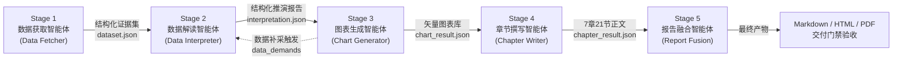
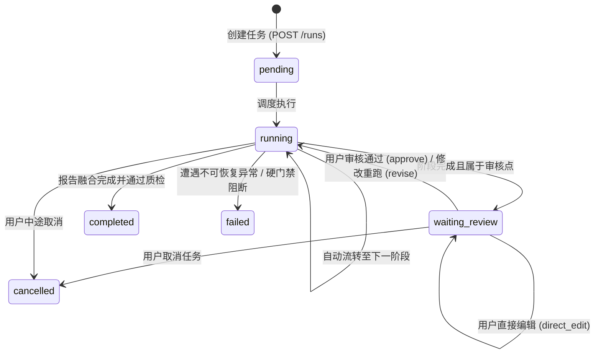

# 基于同花顺问财SkillHub的行业研究报告智能生成与人机协同优化系统
## 全景技术深度解析与工程白皮书

---

## 目录
1. [项目背景与赛题定位](#1-项目背景与赛题定位)
2. [总体系统架构与技术选型](#2-总体系统架构与技术选型)
3. [五阶段多智能体流水线深度解析](#3-五阶段多智能体流水线深度解析)
   - [3.1 Stage 1: 数据获取智能体 (Data Fetcher)](#31-stage-1-数据获取智能体-data-fetcher)
   - [3.2 Stage 2: 数据解读智能体 (Data Interpreter)](#32-stage-2-数据解读智能体-data-interpreter)
   - [3.3 Stage 3: 图表生成智能体 (Chart Generator)](#33-stage-3-图表生成智能体-chart-generator)
   - [3.4 Stage 4: 分章节内容生成智能体 (Chapter Writer)](#34-stage-4-分章节内容生成智能体-chapter-writer)
   - [3.5 Stage 5: 报告融合生成智能体 (Report Fusion)](#35-stage-5-报告融合生成智能体-report-fusion)
4. [同花顺问财 SkillHub 技能生态与调用治理](#4-同花顺问财-skillhub-技能生态与调用治理)
5. [三大核心工程机制设计](#5-三大核心工程机制设计)
   - [5.1 自研有限状态机与 CAS 并发控制](#51-自研有限状态机与-cas-并发控制)
   - [5.2 全程人机协同 (Human-in-the-Loop) 双轨干预体系](#52-全程人机协同-human-in-the-loop-双轨干预体系)
   - [5.3 严格金融语义与 100% 证据穿透溯源链条](#53-严格金融语义与-100-证据穿透溯源链条)
6. [前端交互体系与可视化工作台](#6-前端交互体系与可视化工作台)
7. [质量保障与评测体系 (QA & Benchmarking)](#7-质量保障与评测体系-qa--benchmarking)
8. [系统部署、运行与接口规范](#8-系统部署运行与接口规范)
9. [当前实测状态、瓶颈与演进路线图](#9-当前实测状态瓶颈与演进路线图)

---

## 1. 项目背景与赛题定位

### 1.1 赛题来源与业务痛点
本项目源自同花顺（股票代码：300033）发布的 A 类企业命题：**【A17】基于同花顺问财SkillHub的行业研究报告智能生成与人机协同优化系统设计**。

传统证券与金融投资研究（Sell-side & Buy-side Equity Research）面临高度结构性痛点：
1. **耗时长、人力密集**：撰写一份 20~50 页的深度专题研报通常需要分析师团队花费数天甚至数周，耗费大量时间于跨数据库搜索、搬运数据与排版图表。
2. **多源数据孤岛与口径冲突**：三表数据（资产负债表、利润表、现金流量表）、宏观时序、研报观点与公告披露往往存在统计口径、会计调整（如重述 Restatement）和时间滞后的偏差。
3. **大模型幻觉与黑盒风险**：直接使用通用大语言模型（LLM）端到端生成研报极易产生严重虚构（金融数值编造、因果倒置、伪造来源），无法满足机构投研的审慎合规要求。

### 1.2 系统定位与创新目标
系统将同花顺深耕 20 余年的 **iFinD 金融数据基础设施** 与 **问财 SkillHub 技能生态** 深度整合，采用自研的 **五阶段多智能体流水线（Pipeline Multi-Agent System）**，辅以 **全程人机协同（Human-in-the-Loop, HITL）** 机制，实现：
- **行业研报生产范式升级**：AI 负责高速提数、量化推演、自动绘图与骨架起草；人类分析师把控关键假设、审核事实证据与定稿决策。
- **100% 证据可穿透溯源**：所有核心事实均绑定唯一全局证据编号（`record_id`），直接穿透回溯至交易所公告原件、披露页码、权威数据库及 SHA-256 哈希指纹。
- **出版级规范研报输出**：严格对齐主流券商深度专题研报的标准 **7 章 21 节骨架**，提供 Markdown、富交互 HTML 以及矢量排版 PDF 三格式交付。

---

## 2. 总体系统架构与技术选型

### 2.1 整体架构拓扑
系统采用前后端分离的分层架构，核心分为展示层、网关编排层、智能体核心层、技能生态层与底层存储层：

```
┌────────────────────────────────────────────────────────────────────────┐
│                        前端交互层 (Vue 3 SPA)                          │
│  [CreateRunView] [ReviewView(工作台)] [ReportPreview] [ReportDownload]  │
│  组件库: StageStepper, StageInterventionModal, QualityPanel, EvidenceDrawer │
└───────────────────────────────────┬────────────────────────────────────┘
                                    │ HTTP RESTful / SSE Stream (/api/v1)
┌───────────────────────────────────▼────────────────────────────────────┐
│                  网关编排与运行时层 (FastAPI Orchestrator)              │
│  - API Routes (任务创建/列表/取消/审核/导出/事件流)                      │
│  - StateMachine (自研有限状态机 + 细粒度任务锁 + CAS 提交)                 │
│  - EventHub (内存总线 + JSONL 结构化持久化 + SSE 实时推送)               │
│  - CallLedger (逻辑调用账本: 模型/外呼 Token、延迟、费用审计)            │
└───────────────────────────────────┬────────────────────────────────────┘
                                    │ FiveAgentsAdapter 适配转换
┌───────────────────────────────────▼────────────────────────────────────┐
│                    算法核心层 (agents_core/ 独立 Python 包)             │
│  ┌──────────────┐  ┌──────────────┐  ┌──────────────┐  ┌──────────────┐│
│  │ Stage 1:     │  │ Stage 2:     │  │ Stage 3:     │  │ Stage 4:     ││
│  │ Data Fetcher │─▶│ Data         │─▶│ Chart        │─▶│ Chapter      ││
│  │ (数据获取)   │  │ Interpreter  │  │ Generator    │  │ Writer       ││
│  │              │  │ (数据解读)   │  │ (图表生成)   │  │ (章节撰写)   ││
│  └──────────────┘  └──────────────┘  └──────┬───────┘  └──────┬───────┘│
│                                             │  ▲              │        │
│                                             └──┼──────────────┘        │
│                                          数据补采需求循环               │
│                                                │                       │
│                                        ┌───────▼──────┐                │
│                                        │ Stage 5:     │                │
│                                        │ Report Fusion│                │
│                                        │ (研报融合)   │                │
│                                        └──────────────┘                │
├────────────────────────────────────────────────────────────────────────┤
│                       共享领域引擎与知识层                              │
│  - chain-research: 产业链图谱推演、实体绑定与 SVG 渲染引擎             │
│  - skill_policy: 智能体技能路由策略与权限过滤                          │
│  - financial_semantics: 会计期间、量纲、百分点严格规范定义              │
└───────────────────────────────────┬────────────────────────────────────┘
                                    │ 协议调用 (Tool Invocation)
┌───────────────────────────────────▼────────────────────────────────────┐
│                   同花顺问财 SkillHub 生态 (skills包/)                  │
│  - 官方基础数据技能: 宏观/行业/三表财务/主营业务/公告检索/券商研报等     │
│  - 社区方法论技能: 彼得林奇选股、索罗斯反身性、杜邦分析、周期模型等    │
└────────────────────────────────────────────────────────────────────────┘
```

### 2.2 核心技术选型理念：零黑盒框架
本项目在技术选型上秉持 **“确定性优先、拒绝黑盒封装”** 的工程理念：
- **不依赖 LangGraph / CrewAI / AutoGen 等重型框架**：由于金融研报对状态回滚、局部重算、版本冲突判定和并发锁定有极高的原子性要求，通用框架的隐藏状态与难以预测的重试机制会带来严重的调试困难。系统采用完全自研的 `StateMachine` 状态机，代码显式受控。
- **不依赖外部向量数据库 (Vector DB)**：避免传统 RAG 常见的信息切块断裂、语义召回漂移与来源丢失。数据全部以结构化 JSON 数据集和规范化证据字典在管道各阶段内存和落盘状态中流动。
- **强类型契约校验**：全面采用 Pydantic v2 与 TypeScript 强类型定义，前后端接口契约镜像对齐。
- **矢量化排版闭环**：采用 Playwright 驱动的无头 Chrome 浏览器进行高保真 HTML/CSS 渲染，结合 PyMuPDF 完成 PDF 元数据与双向页码回填，解决传统 WeasyPrint 对现代 CSS3/Flexbox/Grid 支持不足的排版缺陷。

---

## 3. 五阶段多智能体流水线深度解析

系统将行业研报的生产全过程严谨拆解为五个先后递进、职责高度专一的阶段：



---

### 3.1 Stage 1: 数据获取智能体 (Data Fetcher)
- **核心源码路径**：[`agents_core/data-fetcher/data_fetcher/`](file:///Users/panheng/Desktop/同花顺赛题/a17-industry-research-agent/agents_core/data-fetcher/data_fetcher/)
- **输入契约**：`ResearchInput`（行业主题、关注核心问题、市场范围、证券类型、报告币种、基准日期 `research_as_of`、分析深度、用户选定技能等）。
- **主要职责**：
  1. **意图拆解与查询规划 (Query Planning)**：大模型基于用户输入，自动规划出涵盖宏观经济、行业供需、代表性样本上市公司（如宁德时代、比亚迪等）、财务指标矩阵（48 核心指标单元）的查询清单。
  2. **并发技能调度**：面向问财 SkillHub，全并发调度 6 大类核心数据接口（`hithink-macro-query`、`hithink-industry-query`、`hithink-finance-query`、`hithink-business-query`、`announcement-search`、`hithink-insresearch-query` 等）。
  3. **动态查询松弛与降级 (Query Relaxation)**：当下发长尾复杂自然语言问句导致问财接口返回为空时，内置的意图降级机制自动剥离副词与修饰成分，回退至核心实体+财务指标的精确检索。
  4. **证据规范化建模**：将爬取和查询到的原始杂乱数据统一封装为 `EvidenceRecord` 集合：
     - `record_id`：全局唯一证据 ID（如 `R-a1b2c3d4e5`）；
     - `source` / `url`：数据来源（问财官方接口、上交所/深交所官方公告披露）；
     - `as_of` / `period`：严格的业务所属报告期，绝不把“公告发布日期”误作为“财报统计期间”；
     - `sha256`：原始证据文本指纹，防篡改校验。
  5. **产业链图谱抽取 (`chain-research`)**：针对研究行业抽取上游原材料、中游加工制造、下游终端应用的三层拓扑结构与核心竞争企业。

---

### 3.2 Stage 2: 数据解读智能体 (Data Interpreter)
- **核心源码路径**：[`agents_core/data-analysis/data_interpreter/`](file:///Users/panheng/Desktop/同花顺赛题/a17-industry-research-agent/agents_core/data-analysis/data_interpreter/)
- **输入契约**：Stage 1 生成的 `dataset.json` + 用户审核阶段注入的反馈指导。
- **主要职责**：
  1. **确定性金融量化推演引擎 (`engine.py`)**：
     - **复合年均增长率 (CAGR)** 计算：严格按会计年度计算历史复合增速，自动过滤缺失年份；
     - **杜邦分析体系 (DuPont Analysis)**：净资产收益率（ROE）拆解为销售净利率 × 资产周转率 × 权益乘数；
     - **三表勾稽交叉核验**：对资产、负债、营业收入、营业成本、净利润、经营现金流等关键报表项执行勾稽校验，容差范围控制在 `< 1%`。
  2. **可比公司矩阵构建 (Comparable Matrix)**：
     - 提炼代表性龙头企业的核心估值指标（市盈率 P/E、市净率 P/B、企业价值倍数 EV/EBITDA）；
     - 结合历史分位点判定当前行业估值水位（高估/合理/低估）。
  3. **离群值与风险异常检测 (Anomaly Detection)**：
     - 采用稳健统计学算法（Robust Z-score / IQR 结合）识别毛利率异动、应收账款周转恶化或重大债务违约风险，生成结构化风险预警。
  4. **敏感性情景推演 (`sensitivity.py`)**：
     - 针对行业核心变量（如碳酸锂原料价格、补贴政策退出节点等）构建基准、乐观、悲观三种宏观假设与盈利敏感性矩阵。
  5. **证据引用传递**：每个计算出的衍生事实、对标矩阵和异常点，均显式绑定输入证据的 `evidence_record_ids`，杜绝无依据推断。

---

### 3.3 Stage 3: 图表生成智能体 (Chart Generator)
- **核心源码路径**：[`agents_core/chart-generator/chart_generator/`](file:///Users/panheng/Desktop/同花顺赛题/a17-industry-research-agent/agents_core/chart-generator/chart_generator/)
- **输入契约**：Stage 2 的 `interpretation_report.json` + `dataset.json`。
- **主要职责**：
  1. **图表选型与排版自适应**：
     根据数据维度与业务含义自动推荐最佳展示形态：
     - 规模与增速趋势 ➔ **双轴组合图**（柱状图表征绝对金额，折线图表征同比增长率）；
     - 龙头企业综合竞争力 ➔ **多维雷达图**（营收规模、毛利水平、研发投入、ROE、资产周转率）；
     - 行业细分或市场集中度 ➔ **环形饼图 / 瀑布图**；
     - 全产业上下游生态 ➔ **确定性矢量 SVG 产业链拓扑图**。
  2. **货币单位与量纲隔离保护（彻底根治行业顽疾）**：
     - 在 F01/F07 等历史审计缺陷修复中建立严格的量纲守卫（`metric_guard.py`）；
     - 同一坐标轴严禁混用不同单位（如严禁将万元与亿元混在单轴，导致翻倍增长被画成断崖下跌）；
     - 绝对金额轴与比率轴（%）必须严格物理隔离为双轴，强制核对量纲基底。
  3. **双重渲染引擎交付**：
     - **前端交互式渲染**：生成符合 ECharts 规范的结构化 `options` JSON，供网页端缩放、提示框悬浮交互；
     - **离线排版矢量渲染 (`render.py`)**：脱离任何外部依赖，在本地直接编译生成独立、合规、高精度的原生 SVG 矢量代码，直接嵌入报告 HTML/PDF。
  4. **自动数据补采重算机制 (Data Replenishment Loop)**：
     - 若图表规划器判定当前生成出版级图表缺失必要时间点或对标维度（例如缺少某龙头公司 2024 年财报），智能体将生成 `data_demands` 需求包；
     - 后端状态机捕获后，自动触发补采并将结果追加至数据集，退回 Stage 2 重新解读，形成“图表需求驱动提数”闭环。

---

### 3.4 Stage 4: 分章节内容生成智能体 (Chapter Writer)
- **核心源码路径**：[`agents_core/chapter-writer/chapter_writer/`](file:///Users/panheng/Desktop/同花顺赛题/a17-industry-research-agent/agents_core/chapter-writer/chapter_writer/)
- **输入契约**：Stage 2 的解读事实 + Stage 3 的矢量图表清单 + 报告标准大纲。
- **大纲结构（对标顶级券商 7 章 21 节范式）**：
  ```
  CH-01: 行业定义与研究基础  (边界界定 / 口径时点 / 核心矛盾)
  CH-02: 市场规模与成长性    (历史趋势 / 驱动拆解 / 供需周期)
  CH-03: 产业链与利润分配    (上游资源 / 中游制造 / 下游需求议价)
  CH-04: 竞争格局与壁垒      (集中度 CRn / 竞争梯队 / 护城河分析)
  CH-05: 财务质量与估值参照  (盈利能力 / 资产负债现金流 / 估值历史分位)
  CH-06: 宏观、政策与催化    (宏观传导 / 监管合规 / 关键事件日历)
  CH-07: 情景、风险与结论    (三种情景推演 / 风险反证跟踪 / 核心评级结论)
  ```
- **核心机制**：
  1. **全并发章节撰写与独立上下文控制**：
     21 个小节基于各自独立的研究目标（`OutlineSection.purpose`）并发调用大模型。通过 `retriever.py` 进行局部精准上下文检索，严格控制单次 Prompt 的 Token 消耗，防止长文本退化。
  2. **强制微观证据索引穿透**：
     要求大模型撰写正文中的每一个财务事实、政策出台时间或关键论断，必须紧随其证据角标引用（如 `[^R-df642b7447a6]`），与底层证据库形成严格对齐。
  3. **元素精准内嵌**：
     在章节正文中根据语义位置自动注入：
     - 矢量图表 Markdown 语法：``；
     - 重点指标对比卡片（Metric Cards）与可比公司分析表。
  4. **局部重写与定向修订接口**：
     支持人机协同中针对单个章节（如单独重写第 5 章财务估值）发起定向修改，无需重新撰写全部 7 章。

---

### 3.5 Stage 5: 报告融合生成智能体 (Report Fusion)
- **核心源码路径**：[`agents_core/report-fusion/report_fusion/`](file:///Users/panheng/Desktop/同花顺赛题/a17-industry-research-agent/agents_core/report-fusion/report_fusion/)
- **输入契约**：各章节草稿、全局图表、完整证据索引、原始研究输入。
- **主要职责**：
  1. **整篇研报工程化拼装**：
     - 自动撰写并装配：研报封面、标准目录树（TOC）、核心摘要与执行要点（Executive Summary）、免责声明；
     - 组装 4 项权威数据附录（统计附录、离群异常值清单、敏感性推演情景表、100% 穿透证据索引表）。
  2. **4 维一致性严格审计门禁 (Consistency & Fact Audit)**：
     - **结构一致性**：校验是否达成完整的 7 章 21 节，是否出现模型输出截断或整章兜底；
     - **引用一致性**：校验正文中所有引用的证据 ID 是否在总证据库中存在，禁止悬空引用（Dangling References）；
     - **数值口径一致性**：交叉核对摘要中的数值与正文、图表标签中的数值是否完全相符；
     - **图表完整性**：校验规划的图表（默认 6 张）是否全部成功编译并嵌入正文。
  3. **出版级多格式渲染交付**：
     - **Markdown**：输出纯文本规范文档，支持通用阅读器与版本 Diff；
     - **HTML**：结合金融专属主题 CSS、折叠面板与交互式图表展示；
     - **矢量 PDF**：经由无头浏览器驱动的高精度分页打印排版，支持页眉页脚、动态页码和专业金融版式。
  4. **交付门禁机制 (Formal Release vs Restricted Release)**：
     - 若审计通过且证据链完整：开启正式下载入口（HTTP 200）；
     - 若存在硬性证据缺口或降级兜底：锁定正式下载入口（HTTP 409），仅允许以“限制性草稿”形式下载并明确提示未核验项。

---

## 4. 同花顺问财 SkillHub 技能生态与调用治理

### 4.1 技能体系分层与架构
项目将同花顺 SkillHub 的能力划分为两层并与五阶段智能体精准挂载：

| 智能体阶段 | 挂载技能数 | 代表性官方数据技能 | 代表性社区/方法论技能 |
|---|---|---|---|
| **Stage 1: 数据获取** | 25 个 | `hithink-macro-query` (宏观指标)<br/>`hithink-industry-query` (行业全貌)<br/>`hithink-finance-query` (三表财务)<br/>`hithink-business-query` (主营业务拆解)<br/>`announcement-search` (公告检索)<br/>`hithink-insresearch-query` (机构研报) | 板块赛道挖掘技能<br/>事件驱动日历分析<br/>行业数据治理与口径校验 |
| **Stage 2: 数据解读** | 20 个 | 财务报表杜邦分析技能<br/>估值水位与历史分位计算 | 彼得·林奇成长股选股法<br/>索罗斯反身性周期模型<br/>巴菲特护城河分析方法论 |
| **Stage 3: 图表生成** | 6 个 | 宏观时序双轴渲染技能<br/>财务横向对比雷达图技能 | 产业链多级拓扑图技能<br/>排版自愈与单位量纲守卫 |
| **Stage 4: 章节撰写** | 10 个 | 券商深度专题大纲注入技能<br/>微观证据引用锚定技能 | 投行宏观传导分析框架<br/>多情景敏感性推演表述技能 |
| **Stage 5: 报告融合** | 5 个 | 4 维一致性合规审计技能<br/>穿透式证据索引编纂技能 | 出版级矢量排版发布技能<br/>交付门禁与防幻觉校对技能 |

### 4.2 逻辑调用账本与安全治理 (`call_ledger.py`)
在金融级系统运行中，安全合规与成本可核算是关键考核指标：
1. **脱敏调用记账**：系统在 `agents_core/call_ledger.py` 中实现了请求生命周期上下文追踪器。拦截并记录所有外部数据请求和模型调用的延迟（`elapsed_ms`）、HTTP 响应状态码、输入/输出 Token 数量及预估成本。
2. **严防凭证泄漏**：设计明确的脱敏边界，账本和事件流中严禁记录请求 URL 查询串中的敏感密钥、HTTP Authorization 请求头以及包含 Key 报错信息的底层堆栈。
3. **缓存击穿防护**：针对历史公告与静态指标建立本地缓存，命中缓存的请求记录为“1 次逻辑调用、0 次网络请求”，大幅降低 Token 消耗并缩短重试耗时。

---

## 5. 三大核心工程机制设计

### 5.1 自研有限状态机与 CAS 并发控制

#### 状态迁移拓扑
每个研报任务在生命周期中遵循严格的状态迁移拓扑：



#### CAS (Compare-And-Swap) 并发保护与 Revision 演进
在异步多智能体执行过程中，一个典型的竞态缺陷是：**智能体后台计算耗时数分钟，期间人类分析师在界面上修改了某个数据点，后台完成后将全量旧快照写回磁盘，导致人类的编辑被静默吞掉（Silent Overwrite）。**

系统在 [`state_machine.py`](file:///Users/panheng/Desktop/同花顺赛题/a17-industry-research-agent/backend/app/engine/state_machine.py) 中实现了严密的 CAS 控制机制：
1. **输入版本锚定**：当阶段开始执行前，记录当前的任务版本号 `input_revision = state.revision`。
2. **锁内原子校验**：智能体耗时计算结束后，进入 `async with self._run_lock(run_id):` 互斥保护区，重新读取磁盘最新状态 `fresh`。
3. **版本冲突判定**：若 `fresh.revision != input_revision`，说明在计算期间发生了人工编辑或重算请求，系统立即丢弃已过期的后台计算结果，避免版本倒退。
4. **单进程串行化**：审核、取消、重跑与删除操作统一受 `asyncio.Lock` 保护，彻底消除了重复点击“通过”按钮导致的双重并发调度隐患。

---

### 5.2 全程人机协同 (Human-in-the-Loop) 双轨干预体系

系统摒弃了“黑盒一键生成”的传统路线，在每一个阶段出口均提供了标准化、细粒度的人机干预能力：

```
                    ┌─────────────────────────┐
                    │  五阶段人机协同交互动作   │
                    └────────────┬────────────┘
         ┌───────────────────────┼───────────────────────┐
         ▼                       ▼                       ▼
   【流转与决策类】         【数据与内容修正类】     【重跑与调整类】
   - approve (通过)         - direct_edit (直接修改)  - revise (指令反馈修订)
   - accept_with_risks      - customize (结构自定义) - regenerate (整阶段重算)
     (带风险通过)                                    - cancel (终止任务)
```

1. **Stage 1 干预**：用户可审查获取的数据集，勾选剔除噪音数据、人工追加缺失的公司年报记录，或调整检索关键词触发补采。
2. **Stage 2 干预**：提供交互式表格，直接校正可比公司的 P/E、P/B 乘数、营业收入数值，或调整敏感性分析的高低基准情景参数。
3. **Stage 3 干预**：图表样式工作台允许用户切换双轴/单轴、调整图表标题与配色方案、手动重排系列呈现顺序，并在前端实时预览 SVG。
4. **Stage 4 干预**：支持对 21 个小节中的任意单章节提交自然语言反馈（如“请在第 3 章增加固态电池对隔膜环节影响的论述”），系统定向触发单章节重写与拼装。
5. **Stage 5 干预**：支持最终全文标题修改与正文 Markdown 直接修饰。系统自动标记旧质检报告与旧 PDF 失效，保障交付严肃性。

---

### 5.3 严格金融语义与 100% 证据穿透溯源链条

#### 语义规范守卫 (`financial_semantics.py`)
金融数据处理对量纲与时点有着近乎苛刻的要求。系统建立了统一的金融语义转换守卫：
- **报告期间与发布时间分离**：严禁采用发布新闻的日期代替财报归属期。`2024-03-30` 发布的 2023 年报，其统计终点严格判定为 `2023-12-31`。
- **量纲归一化与比率防御**：针对“元、万元、亿元、万亿元”采用精确乘数表转换；针对 `1.5%` 的增长率，严格基于单位标识区分为 `0.015` 或 `1.5 个百分点`，杜绝历史缺陷中“1.5% 误判为 150%”的严重估值偏差。

#### 真实公告重述 (Restatement) 溯源对账
以动力电池研究基准样例中的四家样本公司（宁德时代、比亚迪、国轩高科、亿纬锂能）为例，系统实现了对法定年报重述的精准对账：
- **国轩高科 2023 年毛利率**：溯源至 2024 年报 PDF 第 93、132 页，营业成本由 262.57 亿元追溯调整为 266.21 亿元，毛利率相应由 16.92% 重新复算为 15.77%；
- **宁德时代 2023 年成本列报调整**：溯源至 2024 年报 PDF 第 119、163 页，成本由 3090.70 亿元经列报调整 149.12 亿元调整为 3239.82 亿元，调整后真实毛利率对齐为 19.19%；
- 系统在总证据索引中完整保留**旧值、调整后新值、对应公告原文 PDF 文件名、所在页码与哈希值**，实现金融严谨性。

---

## 6. 前端交互体系与可视化工作台

### 6.1 前端工程与模块架构
前端基于 Vue 3 + TypeScript 5.7 + Vite 6 + Element Plus 构建，严格遵循现代前端工程化规范（ESLint 9 + Prettier，无分号单引号风格）：
- **页面视图 (Views)**：
  - `CreateRunView.vue`：全参数任务发起面板（支持选择研究主题、关注重点、资产类别、预选技能清单、指定人工审核断点阶段）；
  - `ReviewView.vue`：**核心人机协同工作台**。左侧集成任务信息与 5 阶段进度步进器（`StageStepper`），中间为各阶段产物概览（`DataFetchDigest`、`InterpretationDigest`、`ChartGallery`、`ReportPreview`），右侧为操作控制与质检门禁（`ReviewActions`、`QualityPanel`）；
  - `ReportPreviewView.vue`：全屏沉浸式研报阅读器，支持锚点目录树与侧边证据抽屉（`EvidenceDrawer`）穿透回看；
  - `ReportDownloadView.vue`：发布交付中心，具备正式交付门禁锁死与哈希校验展示；
  - `SkillsHubView.vue`：问财技能生态大厅，可视化探索 160+ 个技能模块的入参示例与能力介绍。
- **全屏动线遮罩 (`PipelineOverlay.vue`)**：
  - 长时间同步/异步接口调用期间提供沉浸式高亮动线；
  - 动态呈现当前正在执行的微观动作（如“正在调用 hithink-finance-query 查询宁德时代 2024 年毛利率…”）、当前工具名称与毫秒级计时器。

---

## 7. 质量保障与评测体系 (QA & Benchmarking)

### 7.1 分层测试架构
系统建立了多维度的立体质量防护网，涵盖 Python 单元与集成测试、`eval/` 专项评测套件、前端 Vitest 契约测试与 Playwright 浏览器端到端测试：

```
                    ┌──────────────────────────────┐
                    │      分层测试与验收网格       │
                    └──────────────┬───────────────┘
         ┌─────────────────────────┼─────────────────────────┐
         ▼                         ▼                         ▼
   【后端与智能体测试】          【eval/ 评测层】          【前端与 E2E 验证】
   - 1885+ 离线用例全部通过      - L0 fail-closed 门禁     - 112+ 单元/契约测试
   - 严格离线隔离沙箱            - 真实产物基准回填        - Playwright 真实浏览器
   - 杜绝真实凭证泄漏外呼        - 金融指标黄金公式复算      - 跨阶段组件保存还原验证
```

### 7.2 核心历史缺陷与回归护栏 (F01–F13 闭环)
针对项目前期审查中确认的 13 项核心缺陷（详见历史审查报告 [PROJECT_AUDIT.md](a17-industry-research-agent/docs/PROJECT_AUDIT.md) 与修复台账 [PROJECT_REPAIR_STATUS.md](a17-industry-research-agent/docs/PROJECT_REPAIR_STATUS.md)），全部建立了针对性回归测试护栏：

| 缺陷编号 | 缺陷现象与风险 | 根因 | 最终修复与验证状态 |
|---|---|---|---|
| **F01 (P1)** | 时序图混用金额单位，翻倍画成暴跌 | 各数据点局部归一化，未在系列和坐标轴层统一目标单位 | **已修复**：建立 `metric_guard`，强制统一轴量纲并隔离双轴 |
| **F02 (P1)** | 将同比增长率误当作营业收入金额 | 提取指标时仅用子串模糊匹配首条，无视指标量纲 | **已修复**：建立精确指标标识匹配与百分比过滤器 |
| **F03 (P1)** | 证据去重导致正文引用悬空失效 | 去重时直接按字符串长度丢弃较短证据，未维护既有引用映射 | **已修复**：规范化保留原始 `record_id`，设立端到端引用有效性校验 |
| **F04 (P1)** | 审核接口忽略阶段状态与版本，并发窜乱 | 请求未严格校验 `expected_revision`，缺乏并发写锁 | **已修复**：自研 `StateMachine` 细粒度任务锁 + CAS 原子版本校验 |
| **F05 (P1)** | 质检失败被前端误显为通过 | 质检评分忽略结构化判定，靠文本关键字猜测，覆盖率人工保底 | **已修复**：直接消费 `consistency.passed` 结构化结论，取消虚假保底 |
| **F06 (P1)** | 图表 ID 路径穿越导致 SVG 越界写文件 | 直接将用户传入的 `chart_id` 拼入路径写文件，绕过存储校验 | **已修复**：严格限制图表 ID 命名规范，写入前校验目标在产物目录内 |
| **F07 (P2)** | 1.5% 增长率被放大为 150% | 仅凭 `abs(val)>2` 猜测是否除以 100，缺乏单位强校验 | **已修复**：基于明确的 `%` / `ratio` 单位规则转换数值 |
| **F08 (P2)** | 自动市值校正将个股事实误改成行业总额 | 仅凭文本附近存在“市值”关键词即盲目替换数值 | **已修复**：核验事实严格绑定主体实体与口径，归属不明保留原文 |
| **F09 (P2)** | 编辑融合报告后，下载文件仍为旧版本 | 编辑操作仅更新展示 JSON，未同步废止旧 PDF/HTML 导出 | **已修复**：编辑立即下架旧导出与质检，重新融合方可定稿生成新交付物 |
| **F10 (P2)** | 删除任务后后台写入导致任务复活 | 取消操作未等待正在执行的后台协程完全退出即删目录 | **已修复**：优雅等待所有写者退出后方执行文件物理清理 |
| **F11 (P2)** | 查询有效历史版本接口报 HTTP 500 | 路由分支查到快照后遗漏 `return state` 语句 | **已修复**：补全成功返回分支，完善版本回溯用例 |
| **F12 (P2)** | 界面保存可比公司直接丢弃财务数据 | 前端局部模型与后端契约字段不一致，构造了裁剪后的新对象 | **已修复**：统一共享契约，局部编辑全量回传扩展字段与证据 ID |
| **F13 (P2)** | 运行时重载 `.env` 反向覆盖界面已保存配置 | 采集器内部无条件 `load_dotenv(override=True)` | **已修复**：`.env` 仅作启动默认值，界面配置持久化于独立数据存储 |

---

## 8. 系统部署、运行与接口规范

### 8.1 运行环境要求
- **操作系统**：macOS (Apple Silicon / Intel) 或 Linux (Ubuntu 22.04+ / Debian 12+)
- **Python 环境**：Python 3.11+（推荐 3.11 或 3.12）
- **Node.js 环境**：Node.js 22.x ~ 26.x，npm 10.x+
- **系统工具**：Playwright 浏览器核心（`playwright install chromium`）

### 8.2 快速启动指南
在项目根目录下，提供了高效的一键启动脚本：

```bash
# 进入核心应用目录
cd a17-industry-research-agent

# 1. 安装后端依赖
pip install -r requirements.txt
playwright install chromium

# 2. 安装前端依赖
cd frontend && npm install && cd ..

# 3. 一键启动完整系统 (强制释放 8000 与 5173 端口并拉起服务)
./start_system.sh
```

- **前端工作台**：`http://localhost:5173`
- **后端 API 服务**：`http://localhost:8000/api/v1`
- **Swagger 交互式接口文档**：`http://localhost:8000/docs`

### 8.3 核心 API 端点概览

| 请求方法 | 路由路径 | 功能说明 | 核心参数 / 返回 |
|---|---|---|---|
| `POST` | `/api/v1/runs` | 创建并初始化研报流水线任务 | `RunCreateRequest`（研究主题、审核点配置等） |
| `GET` | `/api/v1/runs` | 分页获取历史研报任务清单 | 任务 ID、当前阶段、状态、修订版本号 |
| `GET` | `/api/v1/runs/{run_id}` | 获取单任务完整运行时状态 | `WorkflowState`（含 5 阶段明细产物与状态） |
| `POST` | `/api/v1/reviews` | **提交人机协同审核与干预指令** | `ReviewRequest`（动作类型、修改数据、修订文本） |
| `GET` | `/api/v1/runs/{run_id}/events/stream` | **SSE 实时事件流** | 流式推送智能体内部微观动线、工具调用与耗时 |
| `GET` | `/api/v1/runs/{run_id}/call-summary` | 获取逻辑调用与费用核算账本 | 模型/问财调用次数、耗时分布、Token 与费用统计 |
| `GET` | `/api/v1/runs/{run_id}/artifacts/{id}` | 下载研报交付产物 | `report.md`, `report.html`, `report.pdf` |
| `GET` | `/api/v1/skills` | 获取当前可用的全部技能大厅目录 | 技能 ID、名称、角色、阶段与描述 |
| `GET/POST` | `/api/v1/settings` | 查询与更新系统大模型/问财配置 | 模型厂商、API Key、Base URL、超时设置等 |

---

## 9. 当前实测状态、瓶颈与演进路线图

### 9.1 当前真实运行验收状态（客观事实）
根据 2026-11-06 最新真实运行审计记录（以动力电池四龙头研究样例为基准）：
- **离线回归验证表现极佳**：全系统离线测试达 **1885 passed、64 skipped、1 deselected**，前端 **112 项测试全部通过**，确定性逻辑与防回归机制高度稳固。
- **真实全链路运行瓶颈**：
  1. **外部大模型服务限流 (HTTP 429)**：在真实联网调度大模型完成规划时，供应商网关连续出现限流阻断，导致部分全链路运行停留在初始规划阶段。
  2. **48 个财务单元的公告原文核验**：当前已完成宁德时代、比亚迪、国轩高科等关键年份毛利率与重述调整的原文人工核验，但要达成 48/48 单元全自动化交易所原文解析，仍需补充针对复杂 PDF 表格排版的通用抽取能力。
  3. **产业链原文证据闭环**：离线已定位天力锂能 2025 年报中关于动力电池产业链的权威披露证据，正在通过状态机将其正式纳入标准输入基准。
- **验收原则**：系统秉持金融严谨态度，在未满足 48 单元全覆盖与 6 张图无缝嵌入前，坚决锁定正式下载（返回 409），仅开放带警告标识的受限预览，绝不对评委和用户伪造“完美通过”。

### 9.2 架构演进与优化路线图
1. **结构性大函数解耦 (针对 A01–A03 架构债务)**：
   - 将 `chart_generator/render.py`（1200+ 行）按图形类型拆分为独立的渲染器策略类；
   - 将 `StageInterventionModal.vue`（2400+ 行）按 5 个阶段拆分为子组件，强化类型契约复用。
2. **多模型灾备与动态降级路由**：
   - 增加模型调用智能重试与自动降级路由（当主模型触发 429 限流时，自动无缝切换至备用 API 端点）。
3. **分布式任务存储适配**：
   - 将当前基于本地文件目录的 `Storage` 抽象为可插拔的存储驱动，支持接入 S3 / MinIO 对象存储与 PostgreSQL 任务状态数据库，赋能企业级多租户高并发部署。

---

> **结语**：本项目展现了一个极具工业级品质的专业金融多智能体研报生成系统。通过将同花顺问财 SkillHub 的坚实数据能力、自研状态机的严密并发控制、全程人机协同的人工把关以及 100% 穿透式的金融证据链有机熔炼为一体，为 AI 时代的金融投研生产力变革交出了一份严谨、可信、优雅的技术答卷。
